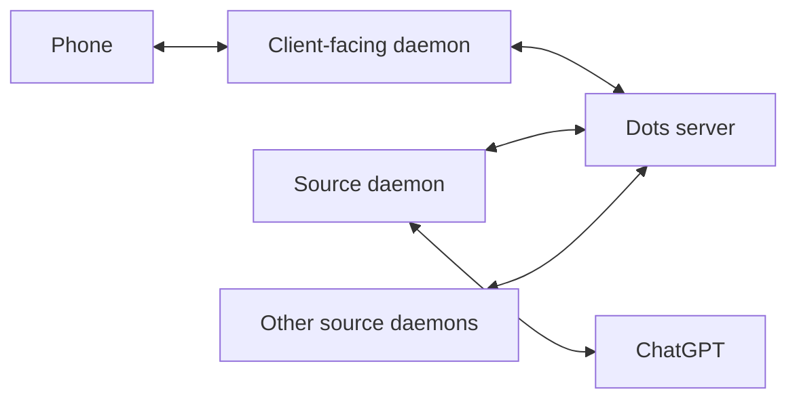

# Dots central hub architecture

Agreed direction, 20 October 2026. The first hosted chat hub is deployed;
provider account Dots still use the Mac source connection.

Dots will have a central server with separate daemons connecting clients and
sources. The phone connects to that central point over the internet or VPN;
it does not need to be near the computer running a source connection. The aim
is a simple client experience with central control over routing and daemons.

The conceptual route is:

**Phone → hosted daemons → Dots server ← hosted daemons ← source / ChatGPT**

Messages and responses travel in both directions:

Both sides establish connections to the hub. Source daemons can run on different
machines and reconnect independently. The phone needs the hub address and its
own saved connection credential, rather than individual source addresses.

## Responsibilities

| Component | Responsibility |
|---|---|
| Dots server | Dot identities and source mappings, routing, durable queues, delivery state, synchronized history, and central controls. |
| Client-facing daemon | Phone connections, reconnect and catch-up, and notification delivery. |
| Source daemons | Provider authentication and session renewal, sending requests, collecting replies, and reporting provider state and available usage information. |
| Phone | Browsing multiple Dots, conversations, setup actions, connection state, and context and credit notices. |

The client-facing daemon and hub can initially share one process and machine.
Their responsibilities remain separate so either can move or expand later.
Multiple source daemons can register with the hub; routing selects the
appropriate connector for each Dot and operation.

## Message delivery and control

### Approval before work

Ordinary conversation, reasoning, recalling context, and read-only lookups used
to answer a question may proceed. Separate jobs, credit-consuming work, coding
jobs, and external actions require explicit approval before they start. The word
research alone must not trigger an approval requirement. A notification after
execution starts, a warning that credits might be used, or a heuristic that
labels a draft as discussion does not satisfy this requirement.

Connectors must submit a proposal describing the task, source, scope, and any
known credit implications. The hub keeps it pending and dispatches only after
approval for that proposal. Approval is not a permanent permission for unrelated
future work. Reconnects and retries must preserve the approval decision and the
operation identity; they must not create a new grant or duplicate execution.

The source must also enforce approval before its own delegated jobs, credit-consuming
work, external actions, or autonomous execution beyond ordinary read-only lookups.
A hub gate cannot control work the provider starts internally without reporting it. If that source cannot honor this boundary, it must remain
paused or unavailable for execution; a conversation-only label or natural-language
instruction is not proof of enforcement. Work visibility remains necessary in
addition to this gate, including started, completed, failed, and approval-needed
states with credit usage when actually reported.

The current ChatGPT connector does not yet provide this guarantee. Pocket was
paused on 20 October 2026 after the user clarified this requirement. Its reported
delegated task list was empty at that check. The user controls Pause and Resume;
opening the app or reconnecting must never change that state automatically.
Maintenance must not substitute an unsolicited pause for a work approval
mechanism. Changes to runtime state should be initiated by the user.

### Current controls

The iPhone app confirms detected work requests before sending, preserves an
approval with the exact pending message for retries, and leaves ordinary research
lookups unblocked. This classification is a client convenience, not proof that a
provider will refrain from autonomous work. Pause and Resume are user actions;
the app reads the provider profile afterward to confirm the resulting state.

The provider Custom rules read endpoint was verified from bundled first-party
source and a live read. The current connection reports canEdit=false, so no
provider rules were changed. A provider-wide hard execution gate remains pending.

### Delivery state

The hub should distinguish queued, handed to a connector, accepted by the
provider, and replied. Reconnects resume from acknowledged events. Stable
request IDs and reconciliation must prevent automatic replay of uncertain
creation or sending operations. Provider idempotency support must be checked
before treating retries as safe.

Central controls should expose connector availability, routing, queue state,
and supported pause or resume actions. Context and credit notices should travel
with provider events. Unknown context usage remains explicitly unknown; a text
estimate must not become an authoritative model context counter.

## Hosting and independence

The hub can run on a hosted machine or here behind the existing VPN. Public
hosting is not required for the first deployment. Ordinary transport protection
and revocable device credentials are sufficient for the initial scope; a new
messaging encryption protocol is not part of this decision.

If the ChatGPT source daemon remains on the Mac, the hub can accept and queue
requests while the Mac is off, but provider replies must wait for that connector.
Moving the source daemon to an always-on host removes this Mac dependency once
provider login and session renewal work there. Moving only the hub does not.

Bluetooth remains an optional local connection rather than the main route for
remote use. Direct phone-to-provider access is not the target architecture.

## Existing work to reuse

- The Dots iPhone app supports multiple Dots and saved pairing credentials.
- The Mac companion and daemon provide the first working provider connection.
  The daemon still needs an adapter that connects outward to the hub.
- Complex has a WebSocket client with reconnect logic talking to `crewd`;
  its connection patterns can inform the hub client.
- Live Bluetooth pairing, reconnect, Pocket creation, and history loading have
  been verified on Joshy. These do not yet verify hosted hub operation.

## Resume when hosting is ready

Record the host and VPN or internet address, the persistent storage location,
and where the first source daemon will run. Then implement the hub protocol and
durable delivery, adapt the existing provider daemon, and connect the phone to
the hub. Verify sending and receiving away from the Mac, reconnect and catch-up,
multiple Dots, and the expected behavior when a connector is offline.

## First hosting deployment

On 20 October 2026, the existing Cherry Cloud VDS 2 at 88.216.68.234 was
selected. A restricted reverse SSH connector now connects the Mac relay to
server loopback port 18769 and reconnects through a Mac LaunchAgent. The server
publishes https://dots.kosmos.institute through the existing HAProxy/Caddy TLS
router. Its Vercel DNS A record points to the Cherry server. Tailscale and the
private forwarding service prepared earlier were removed at the user's request;
the phone needs no VPN. Device authentication remains required.

Authenticated health and read-only provider catalog requests through the server
were verified. The initial transport bridge has been extended with a persistent SQLite hub
and three independent native Codex daemons: Wavesmith, Oscillator and Belle.
The phone can list these agents and create shared rooms. Hosted messages require
approval before Codex turns; native operation approvals return to the phone.
No MCP or automatic model scheduling is used. Hosted history persists; uncertain
turns are never automatically retried. There is no offline execution queue.
Each agent shares one saved session across its rooms. These server agents work
without the Mac; ChatGPT account Dots still require its source connection. See deploy/README.txt for the
deployment, checks, and rollback commands.

## Shared research Bank

A separate non-AI Bank daemon now owns structured research storage. Hosted
agents submit syntheses through native bank_save, bank_search and bank_get tools,
without writing research files or using MCP. The chat router supplies author and
originating chat/session attribution. Phone access uses the existing authenticated
hub and a Bank tab. No additional research loop or scheduler is started.

The Bank uses a private Unix socket and a separate service account; only its
daemon owns its database. Entries retain synthesis, sources, tags and uncertainty.
Corrections append a revision instead of overwriting the original. Native tools
require an active approved turn. Storage and search do not themselves call a
model. The existing ChatGPT account Dot connection does not expose these tools.

## Invited phones and nearby handoff

The iOS and native Android clients share the hosted agents, rooms, approvals and
research Bank. An owner creates a single-use eight-digit invitation valid for
ten minutes. Redemption creates an independent revocable device credential.
Invited devices can use the hosted workspace and approve turns using its
allowance; they cannot manage invitations or access Mac-backed account Dots.
Neither invitation issuance nor redemption requires a model turn or the Mac.

For nearby joining, iPhone Account → Invite a phone → Invite nearby advertises
a separate BLE service. Android Join nearby discovers it, establishes an encrypted
GATT connection, and requests the invitation. The iPhone owner must explicitly
Allow the request before the code is sent. Advertisements contain no invitation
or credentials. Sharing stops on screen dismissal, backgrounding, expiry or
handoff; only the approved central may finish reading that invitation. Android
redeems the code over HTTPS and stores its own credential in Android Keystore.
Further chats use the server without needing Bluetooth range. This handoff was
verified between Joshy and the Samsung SM-A176U on 20 October 2026; no agent
turns were started by verification. See android/README.txt for build and install.

In shared chats, each selected member receives the user message with instructions
to reply only when relevant and useful. An explicit quiet marker is suppressed
from chat history; the task outcome records the quiet member. Each listener
still consumes an approved Codex turn, which both apps disclose before sending.
Agent replies do not dispatch further agent turns. Protocol suppression and
approval gates have fixture tests; live model relevance judgment remains untested.

## People and one-to-one rooms

The room picker now lists authenticated people separately from optional Dots.
One other person with no Dots creates a normal one-to-one conversation: the hub
stores and delivers messages without creating agent jobs or calling a model.
These chats have no AI approval, context meter or agent-response indicator.
The owner chat identity has been initialized to Josh Kornreich from the existing
signed-in profile; a caller can edit their own display name in the picker.
Owner device connections share one person identity. Each invited credential
currently represents one additional person, pending a full multi-device account
system.

Explicit-participant rooms include their creator and restrict listing, history,
posting, profiles, tasks and operation approvals to selected people. Existing
workspace-wide shared rooms keep their previous visibility. Message records have
an authenticated author ID and each viewer receives sender_is_self, keeping the
two humans on the correct sides with names. Legacy messages do not contain enough
identity information to reconstruct who sent them. Dots still reuse their native
sessions across rooms, so including a Dot does not isolate its memory by room.

Hosted-room discovery uses a separate authenticated GET /v1/hosted/rooms endpoint
that never contacts the Mac or provider. Both clients poll while active every two
seconds and refresh on foreground entry. New rooms appear without user refresh;
failed reads keep prior catalog and local state. Catalog revisions prevent a
slower provider response from replacing newer hosted data. Background push
notifications remain separate future work.
